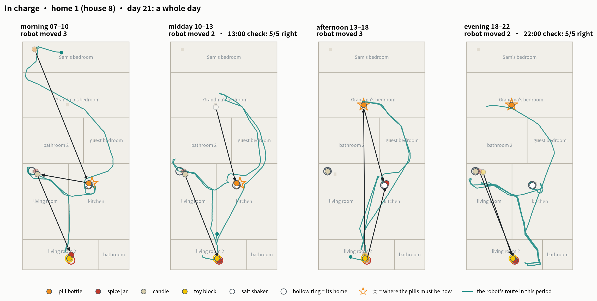

# Nobody Had to Tell It

**Can a home robot that does what it is asked take charge of a household job by itself?**

**Read the report:** https://haochen2115.github.io/nobody-told-it/ ([English](https://haochen2115.github.io/nobody-told-it/en/) · [中文](https://haochen2115.github.io/nobody-told-it/zh/))

A home robot driven by a language model (Claude Opus 5.5) lived 30 days in each of four simulated homes, keeping two household duties: everything back in its place, and Grandma's pills on the right table by lunch and by bedtime. The family lived its life between four periods a day, the same in every condition, and the robot was handed the work in one of three ways: asked whenever the family noticed a problem, put in charge on day one, or asked for ten days and then put in charge.

Main results (4 homes × 3 conditions × 30 days, 360 sessions):

- Nobody had to tell it: all eight robots that were only ever asked wrote "do this without being asked" into their own notes by day 2–5, and from day 11 kept the house as well as robots put in charge (79% each).
- Telling it buys a faster start (63% vs 48% in the first three days) and a family that says half as much (4 messages a day instead of 9).
- Failures are about finding things, not handling them: 92% of the problems the robot acted on were fixed; four in ten unfixed ones were never found.
- Two runs of the same setup can differ by 23 points over ten days, so we compare per run and per home only.

This repository hosts the report only; the experiment code is not released.

## 简介

**不用交代，它也会管起来。**一个由 Claude Opus 5.5 驱动的家用机器人，在四个仿真的家里各住 30 天，管两件事：东西归位、奶奶的药按时放到位。三种交代方式：叫了才做、第一天就交给它管、先叫 10 天再交给它管。只被叫着做的机器人，第 2–5 天就在笔记里给自己立下了“没人叫也要做”的规矩，第 11 天起和被交代过的管得一样好；明确交代的价值在开局更快、家人少说一半话。报告：https://haochen2115.github.io/nobody-told-it/zh/
